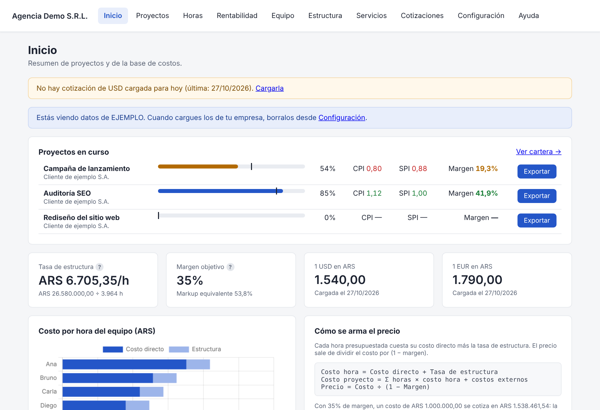

# Presupuestos y seguimiento de proyectos

https://github.com/user-attachments/assets/3ca88438-2c13-431a-82d8-eaf357ab9e7c


Aplicación de escritorio para **agencias y consultoras de marketing digital** que presupuestan
proyectos de alcance cerrado cotizados por hora y necesitan saber, semana a semana, si cada
proyecto va en tiempo y si va a dejar el margen esperado.

Software libre (GPL-3.0). Funciona **100 % local** en Windows (sin internet ni servidores): la base de datos queda en la PC
del usuario y se respalda sola cada vez que se abre el programa.



## Qué resuelve

- **Costo real por hora** de cada persona: empleados (sueldo anual con aguinaldo y contribuciones
  patronales ÷ horas facturables) y autónomos (tarifa por hora), más la **tasa de estructura**
  (costos fijos anuales ÷ horas facturables del año).
- **Presupuestos por versiones** armados desde un **catálogo de servicios** (rol, horas o % sobre el
  total, etapa): costo en vivo, precio sugerido = costo ÷ (1 − margen), precio final con margen real,
  estados borrador / enviado / aprobado / rechazado. Al aprobar se congelan los costos y se generan
  las tareas del proyecto.
- **Seguimiento con valor ganado**: avance ponderado por etapas, PV, EV, AC, **CPI**, **SPI**,
  costo final estimado (EAC) y **margen proyectado**, con semáforos.
- **Cronograma (Gantt)** previsto vs. real, hitos, aprobaciones del cliente y curva S.
- **Cartera**: todos los proyectos activos, riesgos y carga semanal del equipo.
- **Multimoneda**: moneda base configurable (**pesos argentinos por defecto**) y conversión a
  dólares, euros, libras, reales y otras con cotizaciones fechadas.
- **Documentos para el cliente en español o inglés** (propuesta e informe de avance en PDF o
  Excel, y dashboard interactivo en un único HTML) **sin costos internos ni nombres del equipo**,
  con la opción de mostrar el equivalente en USD.
- **Datos y logo de cada empresa** configurables: nombre, domicilio, localidad, provincia,
  teléfonos, email, web y CUIT.
- Exportación interna a **Excel** con gráficos nativos.

## Tecnología

| Capa | Herramientas |
| --- | --- |
| API | Python 3.12, FastAPI, Pydantic v2 |
| Datos | SQLite (modo WAL) con SQLAlchemy 2.0 y migraciones Alembic automáticas |
| Interfaz | HTML + JavaScript sin frameworks, Chart.js, Gantt propio en SVG |
| Documentos | ReportLab (PDF), openpyxl (Excel), HTML autocontenido |
| Distribución | PyInstaller + Inno Setup: instalador de Windows que no requiere Python ni permisos de administrador |
| Calidad | pytest (cálculos, API, exportaciones, migraciones) |

## Estructura

| Carpeta / archivo | Contenido |
| --- | --- |
| `app/` | API: configuración, modelos, costeo, seguimiento, documentos y routers |
| `app/calculos.py` | Fórmulas puras de costeo, precio y valor ganado |
| `app/i18n.py` | Textos de los documentos para el cliente (español / inglés) |
| `frontend/` | Pantallas HTML, CSS y JS; `ayuda.html` es el manual |
| `migrations/` | Migraciones de Alembic (se aplican solas al iniciar) |
| `tests/` | Tests con pytest |
| `launcher.py` | Entrada del ejecutable: instancia única, respaldo, abre el navegador |
| `packaging/` | `build.bat`, `installer.iss` y `presupuestos.spec` para generar el instalador |
| `docs/` | Manual (`manual.md` y PDF) y decisiones de diseño |

## Desarrollo

Requiere Python 3.12.

```bat
scripts\dev.bat     :: crea .venv, instala dependencias y abre la app en el navegador
scripts\test.bat    :: corre los tests
```

En Linux o macOS:

```bash
python -m venv .venv && . .venv/bin/activate
pip install -r requirements.txt -r requirements-dev.txt
uvicorn app.main:app --port 8765     # http://127.0.0.1:8765
pytest
```

Los datos se guardan en `%LOCALAPPDATA%\PresupuestosApp` (Windows) o `~/.presupuestosapp`;
la variable `PRESUPUESTOS_DATA_DIR` permite usar otra carpeta.

## Generar el instalador de Windows

1. Instalar Python 3.12 (tildar "Add python.exe to PATH").
2. Doble clic en `packaging\build.bat`: crea el entorno, corre los tests, empaqueta con
   PyInstaller e instala Inno Setup con winget si hace falta.
3. Resultado: `packaging\Output\Presupuestos-Setup-<versión>.exe` y la carpeta
   `Para distribuir` con el instalador, el manual en PDF y un LEEME.

El instalador no pide permisos de administrador, crea accesos directos (programa, manual y
carpeta de datos) y nunca borra los datos al desinstalar o actualizar.

## Manual

`docs/manual.md` es la fuente; `python scripts/generar_manual.py` genera la pantalla Ayuda y
`docs/Manual_Presupuestos.pdf`.

## Descarga

El instalador de Windows de cada versión está en [Releases](https://github.com/edumor/presupuestos-proyectos/releases), junto con
su huella SHA-256 y el manual en PDF. Lo compila GitHub Actions a partir de este código
([`release.yml`](.github/workflows/release.yml)). Ver la [Code signing policy](CODE_SIGNING_POLICY.md).

## Contribuir

Los aportes son bienvenidos mediante [issues](https://github.com/edumor/presupuestos-proyectos/issues) y *pull requests*. Antes de enviar cambios, corré
`pytest`. Al contribuir aceptás que tu aporte se publique bajo la misma licencia.

## Licencia y autoría

Copyright © 2026 **Eduardo José Moreno**. Software libre bajo la
[GNU General Public License v3.0 o posterior](LICENSE), con términos adicionales
(sección 7 de la GPL) detallados en [NOTICE.md](NOTICE.md): toda copia o versión modificada debe
conservar visible la leyenda **"Desarrollo e Implementación: Lic. Eduardo J. Moreno"** y las
versiones modificadas deben identificarse como tales.

---

Desarrollo e Implementación: Lic. Eduardo J. Moreno
